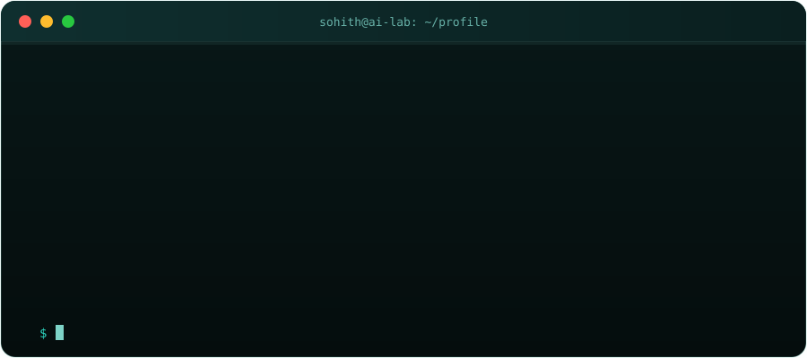



  

 

<h2>🚀 Featured Projects</h2>

<table>
<tr>
<td></td>
<td></td>
</tr>
<tr>
<td></td>
<td></td>
</tr>
</table>

<h2>🔥 Consistency</h2>

  

<h2> Contribution activity graph</h2>

 

 

